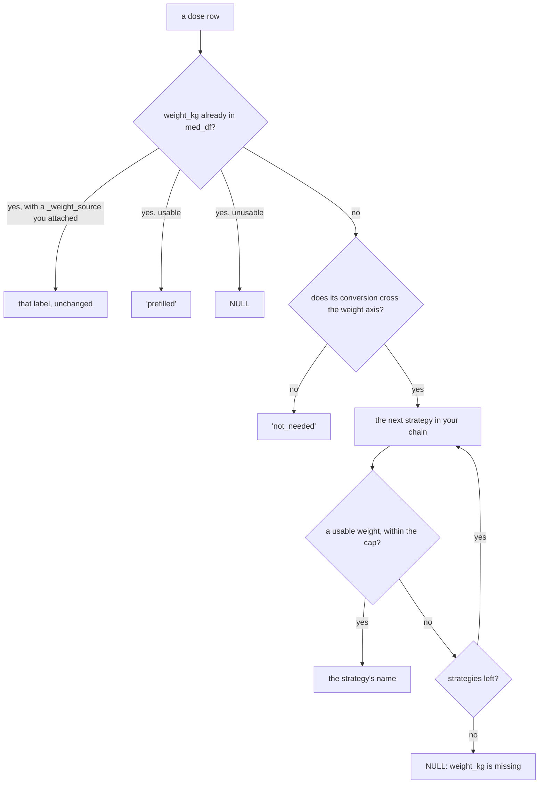

# Medication Unit Conversion

CLIFpy converts medication doses between unit systems, so that every dose of a
drug can be analysed on one scale even when it was charted in different units.
Give `standardize_med_dose_units` a CLIF mCIDE targets file, or a dictionary
of the target units you choose.

The examples on this page run as written. They use the open 100-patient CLIF
3.0 demo in clifpy's source tree (time zone `Etc/GMT+5`) and need no network.
They work in polars, the format `load_data` returns and the converter's
default output (see [Inputs and return formats](#inputs-and-return-formats)):

```python
from pathlib import Path

import polars as pl

import clifpy
from clifpy.utils.io import load_data
from clifpy.utils.unit_converter import (
    WEIGHT_FALLBACKS,
    attach_weight,
    convert_dose_units_by_med_category,
    load_dose_unit_targets,
    standardize_dose_to_base_units,
    standardize_med_dose_units,
)

DEMO = str(Path(clifpy.__file__).parent / "data" / "clif_demo" / "3.0")
TZ = "Etc/GMT+5"


def load_demo(table, **kwargs):
    """Load one demo table as a polars DataFrame, load_data's default."""
    return load_data(table, DEMO, "parquet", site_tz=TZ, **kwargs)


mac_df = load_demo("medication_admin_continuous")
mai_df = load_demo("medication_admin_intermittent")
vitals_df = load_demo("vitals", filters={"vital_category": ["weight_kg"]})
hosp_df = load_demo("hospitalization")
```

## Standardize against the mCIDE targets

`med_category` target units are published in CLIF's mCIDE files. Point clifpy
at one and the whole table is standardized in one call. With your own data:

```text
from clifpy.utils.unit_converter import standardize_med_dose_units

# a local path or a URL; this one is pinned to a commit
TARGETS_URL = (
    "https://raw.githubusercontent.com/Common-Longitudinal-ICU-data-Format/CLIF/"
    "7bd928295ea68ff7a196cf5a9c6c1ef84b41bd1d/mCIDE/medication_admin_continuous/"
    "clif_medication_admin_continuous_med_categories.csv"
)
converted, counts = standardize_med_dose_units(mac_df, targets=TARGETS_URL, vitals_df=vitals_df)
```

Instead of pointing to a file, you can supply a dictionary of
`{med_category: target_unit}`. The examples on this page do:

```python
targets = {
    "norepinephrine": "mcg/kg/min",
    "propofol": "mcg/kg/min",
    "fentanyl": "mcg/hr",
    "insulin": "units/hr",
    "heparin": "units/kg/hr",
    "vasopressin": "units/min",
}

converted, counts = standardize_med_dose_units(mac_df, targets, vitals_df=vitals_df)
converted.group_by("_convert_status_details").len().sort("_convert_status_details")
```

You get two tables, the converted rows and the status breakdown; see
[Read the results](#read-the-results).

### Strict and lenient runs

`standardize_med_dose_units` defaults to `override=True`, unlike
`convert_dose_units_by_med_category`: a targets file lists a few hundred
categories, and any your data lacks would otherwise raise a `ValueError`.
`override=True` also turns two real errors into warnings: a target unit clifpy
cannot parse, and a missing `vitals_df` when a row needs a patient weight.
Check the log, or pass `override=False`.

## Read the results

Every call returns two tables, `(converted, counts)`:

1. **the converted table**: your rows, in your order, with the conversion
   added;

2. **the status breakdown** (`counts`): one row per category, source unit and
   outcome, with how many rows took that path. Read this one first: it shows
   in a few dozen rows what happened to millions.

### The converted table

The default output is lean: your columns plus

- `med_dose_converted`, `med_dose_unit_converted`: the dose in its target
  unit. A row that fails keeps its original dose, and its unit is the cleaned
  source unit.

- `_convert_status`: `'success'`, or why the row did not convert. `'success'`
  still marks every converted row, so `== 'success'` filters keep working
  (some failure reasons changed since `main`; see
  [Migration from main](#migration-from-main)).

- `_convert_status_details`: how a successful row got its unit, or the
  failure reason again (see
  [How each row reached its unit](#how-each-row-reached-its-unit)).

- `weight_kg`, `_weight_source`, `_weight_age_hours`: the patient weight the
  row used, how it was settled and how old it was at the dose (see
  [Patient weight lookup](#patient-weight-lookup)).

`show_intermediate=True` adds the QA columns (`_clean_unit`, `_unit_class`,
`_base_unit`, the multipliers, `_weight_recorded_dttm`). Use it to debug one
category; the status breakdown already carries the QA columns you need for a
review.

### The status breakdown table

The breakdown groups the rows by category, source unit and outcome. Its
columns come in review order:

| column | what it tells you |
|---|---|
| `med_category` | the category, as charted |
| `med_dose_unit` | the source unit, as charted |
| `_preferred_unit` | the target: yours, or the row's own unit when the category has none |
| `med_dose_unit_converted` | the unit that came out |
| `_convert_status_details` | how the rows got there, or why not |
| `_weight_source` | how their patient weight was settled |
| `count` | how many rows took this path |
| `_clean_unit`, `_base_unit`, `_unit_class`, `_convert_status` | QA detail: the cleaned and base units, the unit class, the backward-compatible status |

It is sorted by category, then by count, so each category's largest group
comes first. Units are spelled out (`units/hr`, `milli-units/min`), except a
target you wrote, which is echoed as written.

#### A messy table, read row by row

The demo data are clean, so this example makes up a small table with one row
for each thing that goes wrong in real medication data. Stay H1 has a weight
charted at 08:00; H2's only weight is charted an hour after its dose; H3's only
weights are 0 and NaN; H4 has none. The targets dict lists a category the data
lacks (`dopamine`) and leaves two out (`insulin`, and a misspelled
`Norepinephrine `):

```python
from datetime import datetime


def at(hour):
    return datetime(2024, 3, 10, hour)


anomaly = pl.DataFrame(
    [
        ("H1", at(10), "norepinephrine", 8.0, "mcg/min"),
        ("H1", at(11), "norepinephrine", 0.1, "MCG/KG/MIN"),
        ("H1", at(12), "Norepinephrine ", 5.0, "mcg/min"),
        ("H2", at(10), "propofol", 20.0, "mg/hr"),
        ("H3", at(10), "propofol", 30.0, "mg/hr"),
        ("H1", at(13), "fentanyl", 50.0, None),
        ("H1", at(14), "fentanyl", 1.0, "tablet"),
        ("H1", at(15), "fentanyl", 2.0, "mcg/dose"),
        ("H1", at(16), "heparin", 18.0, "Units/kg/Hour"),
        ("H1", at(17), "heparin", 1000.0, "units/hr"),
        ("H1", at(18), "vasopressin", 0.04, "U/min"),
        ("H1", at(19), "penicillin_g", 5.0, "MU"),
        ("H1", at(20), "sodium_chloride_0_9_pct", 100.0, "mg/hr"),
        ("H1", at(21), "insulin", 4.0, "Units/Hour"),
        ("H1", at(22), "ondansetron", 4.0, "mg"),
        ("H1", at(23), "nicotine", 1.0, "patch"),
        ("H4", at(10), "epinephrine", 50.0, "ng/kg/min"),
    ],
    schema=["hospitalization_id", "admin_dttm", "med_category", "med_dose", "med_dose_unit"],
    orient="row",
)
anomaly_weights = pl.DataFrame(
    [
        ("H1", at(8), "weight_kg", 70.0),
        ("H2", at(11), "weight_kg", 80.0),
        ("H3", at(8), "weight_kg", 0.0),
        ("H3", at(9), "weight_kg", float("nan")),
    ],
    schema=["hospitalization_id", "recorded_dttm", "vital_category", "vital_value"],
    orient="row",
)
anomaly_targets = {
    "norepinephrine": "mcg/kg/min",
    "propofol": "mcg/kg/min",
    "fentanyl": "mcg/hr",
    "heparin": "units/kg/hr",
    "vasopressin": "units/min",
    "penicillin_g": "million-units",
    "sodium_chloride_0_9_pct": "ml/hr",
    "ondansetron": "mg/hr",
    "nicotine": "patch",
    "epinephrine": "mcg/kg/min",
    "dopamine": "mcg/kg/min",
}
anomaly_out, anomaly_counts = standardize_med_dose_units(
    anomaly, anomaly_targets, vitals_df=anomaly_weights
)
```

Its breakdown, the review columns only:

<!-- anomaly-outcomes:begin -->

| `med_category` | `med_dose_unit` | `_preferred_unit` | `med_dose_unit_converted` | `_convert_status_details` | `_weight_source` | `count` |
|---|---|---|---|---|---|---|
| `Norepinephrine ` | `mcg/min` | `mcg/min` | `mcg/min` | `success: no target listed; unit cleaned only` | `not_needed` | 1 |
| `epinephrine` | `ng/kg/min` | `mcg/kg/min` | `mcg/kg/min` | `success: converted to the target unit` | `not_needed` | 1 |
| `fentanyl` | `tablet` | `mcg/hr` | `tablet` | `original unit tablet is a countable dosage form; not convertible` | `not_needed` | 1 |
| `fentanyl` | NULL | `mcg/hr` | NULL | `original unit is missing` | `not_needed` | 1 |
| `fentanyl` | `mcg/dose` | `mcg/hr` | `mcg/dose` | `original unit mcg/dose is not recognized` | `not_needed` | 1 |
| `heparin` | `Units/kg/Hour` | `units/kg/hr` | `units/kg/hr` | `success: already the target unit` | `not_needed` | 1 |
| `heparin` | `units/hr` | `units/kg/hr` | `units/kg/hr` | `success: converted to the target unit` | `asof` | 1 |
| `insulin` | `Units/Hour` | `units/hr` | `units/hr` | `success: no target listed; unit cleaned only` | `not_needed` | 1 |
| `nicotine` | `patch` | `patch` | `patch` | `success: already the target unit` | `not_needed` | 1 |
| `norepinephrine` | `mcg/min` | `mcg/kg/min` | `mcg/kg/min` | `success: converted to the target unit` | `asof` | 1 |
| `norepinephrine` | `MCG/KG/MIN` | `mcg/kg/min` | `mcg/kg/min` | `success: already the target unit` | `not_needed` | 1 |
| `ondansetron` | `mg` | `mg/hr` | `mg` | `cannot convert amount to rate` | `not_needed` | 1 |
| `penicillin_g` | `MU` | `million-units` | `milli-units` | `cannot convert milli-units to million-units (ambiguous 'MU')` | `not_needed` | 1 |
| `propofol` | `mg/hr` | `mcg/kg/min` | `mg/hr` | `cannot convert unweighted to weighted: weight_kg is missing` | NULL | 2 |
| `sodium_chloride_0_9_pct` | `mg/hr` | `ml/hr` | `mg/hr` | `cannot convert mass to volume` | `not_needed` | 1 |
| `vasopressin` | `U/min` | `units/min` | `units/min` | `success: already the target unit` | `not_needed` | 1 |

<!-- anomaly-outcomes:end -->

<!-- invisible-code-block: python
# The table above is the code's real output: parse it back and compare.
from pathlib import Path as _Path

_text = _Path("docs/user-guide/med-unit-conversion.md").read_text(encoding="utf-8")
# (marker names only: a literal comment end would close this hidden block)
_block = _text.split("anomaly-outcomes:begin")[1].split("anomaly-outcomes:end")[0]


def _cell(c):
    c = c.strip()
    return None if c == "NULL" else (c[1:-1] if c.startswith("`") else int(c))


_shown = {
    tuple(_cell(c) for c in line.strip().strip("|").split("|"))
    for line in [l for l in _block.splitlines() if l.startswith("|")][2:]
}
_cols = ["med_category", "med_dose_unit", "_preferred_unit", "med_dose_unit_converted",
         "_convert_status_details", "_weight_source", "count"]
assert _shown == set(anomaly_counts.select(_cols).iter_rows()), "regenerate the anomaly table"
-->

Reading it:

- **Converted.** `norepinephrine` in `mcg/min` reached `mcg/kg/min`; its rows
  needed a weight, and `_weight_source` says the `asof` strategy found one. So
  did `heparin` in `units/hr`. `epinephrine` in `ng/kg/min` only changed its
  mass unit, so it needed no weight (`not_needed`).

- **Already the target.** `MCG/KG/MIN`, `Units/kg/Hour` and `U/min` are
  spellings of the target, so their dose was copied unchanged. So was
  `nicotine` in `patch`: a countable form is a valid target when the row is
  already in it.

- **No target listed.** `insulin` (a CLIF 2.1 name) and `Norepinephrine `
  (a trailing space) are not in the targets, so their rows keep their dose as
  charted; clifpy also logs a WARNING naming them, the drifted spelling first.

- **A weight was needed and none was found.** Both `propofol` rows: `_weight_source`
  is NULL, the dose is kept, and the status says which way the conversion
  needed one. H2 is recovered by a fallback strategy (see
  [Fallback strategies](#fallback-strategies)); H3 is not, because weights of
  zero or below and NaN are discarded.

- **Failed, by design.** A missing unit, a countable form that is not the
  target (`tablet`), an unparseable unit (`mcg/dose`), the ambiguous `MU`, an
  amount against a rate target (`ondansetron`) and a mass against a volume
  target (`sodium_chloride_0_9_pct`). Each keeps its dose. See
  [What clifpy guards against](#what-clifpy-guards-against) for each one.

<!-- invisible-code-block: python
_by = {(r[0], r[1]): r for r in anomaly_counts.iter_rows()}
_d = anomaly_counts.columns.index("_convert_status_details")
_w = anomaly_counts.columns.index("_weight_source")
assert _by[("propofol", "mg/hr")][anomaly_counts.columns.index("count")] == 2
assert _by[("propofol", "mg/hr")][_w] is None
assert _by[("nicotine", "patch")][_d] == "success: already the target unit"
-->

#### Filter recipes

What did not convert, largest groups first:

```python
anomaly_counts.filter(pl.col("_convert_status") != "success").sort("count", descending=True)
```

What was left as charted because no target was listed:

```python
anomaly_counts.filter(
    pl.col("_convert_status_details").str.starts_with("success: no target listed")
)
```

Rows that needed a weight and found none, in the converted table:

```python
no_weight = anomaly_out.filter(pl.col("_convert_status").str.ends_with("weight_kg is missing"))
assert no_weight.height == 2
```

This works whoever attached the weights. `_weight_source` NULL means the same
only when the converter looked them up itself: with a pre-filled `weight_kg`,
a row that needs no weight reads `'prefilled'` or NULL too.

<!-- invisible-code-block: python
_prefilled, _ = convert_dose_units_by_med_category(
    pl.DataFrame({
        "hospitalization_id": ["P1", "P1", "P1"],
        "admin_dttm": [datetime(2024, 1, 1, 8)] * 3,
        "med_category": ["x", "y", "y"],
        "med_dose": [0.1, 2.0, 2.0],
        "med_dose_unit": ["mcg/kg/min", "mg/hr", "mg/hr"],
        "weight_kg": [0.0, 0.0, None],
    }),
    preferred_units={"x": "mcg/min", "y": "mcg/min"},
)
assert _prefilled.filter(pl.col("_convert_status").str.ends_with("weight_kg is missing")).height == 1
assert _prefilled.filter(pl.col("_weight_source").is_null()).height == 3
-->

The breakdown joins back onto the rows on the columns both carry, many rows to
one group:

```python
review = ["med_category", "med_dose_unit", "med_dose_unit_converted",
          "_convert_status_details", "_weight_source"]
rows_with_count = anomaly_out.join(
    anomaly_counts.select(*review, "count"), on=review, how="left",
    nulls_equal=True, validate="m:1",
)
assert rows_with_count.height == anomaly_out.height
```

For a second column pair, the QA columns carry the pair's suffix
(`_convert_status_details__volume_infusion_rate`); see
[Converting a second column pair](#converting-a-second-column-pair).

### How each row reached its unit

`_convert_status` is `'success'`, or the reason a row failed (see
[The `_convert_status` Column](#the-_convert_status-column)). `_convert_status_details`, next to it in
the converted table and in the counts table, says *how* a successful row got
its unit, and repeats the reason for a failed one:

| `_convert_status_details` | when |
|---|---|
| `success: converted to the target unit` | a listed target; the dose was multiplied by a conversion factor |
| `success: already the target unit` | a listed target the row was already in (`Units/Hour` against `units/hr` too); the dose is copied exactly |
| `success: converted to the weight variant of the target` | `allow_weight_variant=True`: `mg/kg/hr` against `mcg/hr` became `mcg/kg/hr` (see [below](#accepting-a-targets-weight-variant)) |
| `success: already the weight variant of the target` | `allow_weight_variant=True`: a `mcg/kg/hr` row against `mcg/hr`, copied |
| `success: no target listed; unit cleaned only` | the category has no target (`unlisted='keep'`, the default of `standardize_med_dose_units`): the dose is copied and only the unit's spelling is cleaned |
| `success: no target listed; converted to the base unit` | no target, `unlisted='base'` (the default of `convert_dose_units_by_med_category`): converted to clifpy's [base unit](#standardize-to-base-units-across-medications), e.g. `mg` to `mcg` |
| `success: no target listed; already the base unit` | no target, `unlisted='base'`, and the row was already in its base unit |
| any failure | the same text as `_convert_status`, e.g. `cannot convert rate to amount` |

To keep only rows that reached a listed target (or its variant), filter
`~pl.col("_convert_status_details").str.contains("no target listed")` as well
as `_convert_status == 'success'`. Rows whose dose was copied unchanged read
`... already ...` or `... unit cleaned only`.

```python
kept = converted.filter(
    pl.col("_convert_status_details") == "success: no target listed; unit cleaned only"
)
assert kept.select(pl.col("med_dose_converted").eq_missing(pl.col("med_dose")).all()).item()
```

A category the targets do not list is not an error: under `unlisted='keep'`
its dose stays as charted, and `unlisted='base'` converts it to clifpy's base
unit instead. clifpy logs one WARNING naming the unlisted categories, spelling
drift first. For the full list, filter the data on its categories:
`mac_df.filter(~pl.col("med_category").is_in(list(targets)))`.

## Patient weight lookup

A weight is needed **only** when a conversion crosses the weight axis:
weighted to unweighted (`mcg/kg/min → mcg/min`) or the reverse
(`mg → mcg/kg`). `/kg ↔ /lb` is a constant factor, and every other conversion
never looks at weight; those rows read `_weight_source = 'not_needed'`. When
`med_df` has no `weight_kg` column and a row crosses the axis, the converter
looks a weight up in `vitals_df` (`vital_category = 'weight_kg'`).

By default the lookup is a single **as-of** match: the latest weight at or
before the dose, in the same stay. A dose given before anyone charted a weight
then fails with `cannot convert ... weight_kg is missing`, and that is common:
the first weight of a stay is often charted after a drug started. Drugs
started in the first minutes of a stay (naloxone, vasopressors) are the worst
affected. A fallback chain recovers those rows.

### Fallback strategies

Five made-up stays, one dose each at 2024-03-10 10:00, show what each
strategy picks. The cross-stay strategies also read each patient's other
stays, so the frames include a January stay of H_PRIOR's patient and a May
stay of H_LATER's:

```python
def ts(text):
    return datetime.fromisoformat(text)


# five stays, one dose each, all at 2024-03-10 10:00
stays_doses = pl.DataFrame({
    "hospitalization_id": ["H_ASOF", "H_AFTER", "H_PRIOR", "H_LATER", "H_NONE"],
    "admin_dttm": [ts("2024-03-10 10:00")] * 5,
})
stays_weights = pl.DataFrame(
    [
        ("H_ASOF", ts("2024-03-10 08:00"), 70.0),
        ("H_ASOF", ts("2024-03-10 09:00"), 72.0),
        ("H_ASOF", ts("2024-03-10 11:00"), 80.0),
        ("H_AFTER", ts("2024-03-10 11:00"), 75.0),
        ("H_AFTER", ts("2024-03-10 13:00"), 77.0),
        ("H_P3_OLD", ts("2024-01-02 09:00"), 68.0),   # H_PRIOR's patient, in January
        ("H_P3_OLD", ts("2024-01-03 09:00"), 69.0),
        ("H_P4_NEW", ts("2024-05-02 09:00"), 90.0),   # H_LATER's patient, in May
        ("H_P4_NEW", ts("2024-05-05 09:00"), 91.0),
    ],
    schema=["hospitalization_id", "recorded_dttm", "vital_value"],
    orient="row",
).with_columns(vital_category=pl.lit("weight_kg"))
stays = pl.DataFrame(
    [
        ("H_ASOF", "P1", ts("2024-03-09 00:00")),
        ("H_AFTER", "P2", ts("2024-03-09 00:00")),
        ("H_P3_OLD", "P3", ts("2024-01-01 00:00")),
        ("H_PRIOR", "P3", ts("2024-03-09 00:00")),
        ("H_LATER", "P4", ts("2024-03-09 00:00")),
        ("H_P4_NEW", "P4", ts("2024-05-01 00:00")),
        ("H_NONE", "P5", ts("2024-03-09 00:00")),
    ],
    schema=["hospitalization_id", "patient_id", "admission_dttm"],
    orient="row",
)


def served(chain, **kwargs):
    """Which strategy served each stay's dose, with the weight and its age."""
    return attach_weight(
        stays_doses, stays_weights, fallbacks=chain, hospitalization_df=stays, **kwargs
    ).select("hospitalization_id", "_weight_source", "weight_kg", "_weight_age_hours")

served(WEIGHT_FALLBACKS)
```

<!-- invisible-code-block: python
assert served(WEIGHT_FALLBACKS).rows() == [
    ("H_ASOF", "asof", 72.0, 1.0),
    ("H_AFTER", "same_hosp_earliest", 75.0, -1.0),
    ("H_PRIOR", "prior_hosp_latest", 69.0, 1609.0),
    ("H_LATER", "later_hosp_earliest", 90.0, -1271.0),
    ("H_NONE", None, None, None),
]
-->


*Figure 1. What each strategy serves. Filled circles are the weights served;
`_weight_age_hours` is positive when the weight was charted before the dose.*

| strategy | weight used | in the example |
|---|---|---|
| `asof` | the latest weight at or before the dose, same stay (a weight at the dose instant counts, age 0) | H_ASOF: 72 kg from 09:00, not the 11:00 one |
| `same_hosp_earliest` | the stay's earliest weight | H_AFTER: 75 kg from 11:00, an hour after the dose |
| `prior_hosp_latest` | the latest weight of the patient's stays admitted **before** this one | H_PRIOR: 69 kg from January |
| `later_hosp_earliest` | the earliest weight of the patient's stays admitted **at or after** this one | H_LATER: 90 kg from May |

No strategy helps H_NONE, whose patient has no weight anywhere: its row keeps
a NULL weight and fails in `_convert_status`. Weights charted at the same
instant for the same stay are averaged, so the result does not depend on row
order. Two stays admitted at the same instant count as *later* to each other,
never *prior*.

### The chain

`weight_fallbacks` (on the converter; `fallbacks` on `attach_weight`) is an
ordered chain. For each row, the first strategy that finds a usable weight
wins:



*Figure 2. How each row's `_weight_source` is settled. Usable means above
zero and finite. A pre-filled `weight_kg` labels every row, whether or not
its conversion needs a weight.*

Each strategy added recovers more stays:

```python
for chain in [("asof",), ("asof", "same_hosp_earliest"), WEIGHT_FALLBACKS]:
    print(chain, served(chain)["_weight_source"].to_list())
```

`("asof",)` serves H_ASOF only; adding `same_hosp_earliest` recovers H_AFTER;
the full `WEIGHT_FALLBACKS` serves all but H_NONE. The order is yours, and it
matters: put `same_hosp_earliest` first and H_ASOF takes its 08:00 weight
(70 kg) instead of the 09:00 one, because the earliest weight now wins:

```python
served(("same_hosp_earliest", "asof")).filter(pl.col("hospitalization_id") == "H_ASOF")
```

<!-- invisible-code-block: python
assert served(("asof",))["_weight_source"].to_list() == ["asof", None, None, None, None]
assert served(("asof", "same_hosp_earliest"))["_weight_source"].to_list()[:2] == ["asof", "same_hosp_earliest"]
assert served(("same_hosp_earliest", "asof")).row(0) == ("H_ASOF", "same_hosp_earliest", 70.0, 2.0)
-->

The chain must be a tuple or list of known names, each once:

- a set raises a `TypeError`, because its order changes between runs;

- a bare string raises `fallbacks must be a sequence of strategy names, not a
  str; did you mean ('asof',)?`;

- an unknown name raises, listing the four valid ones.

**Recommended: `("asof", "same_hosp_earliest")`.** It recovers most of the
stays that fail under as-of alone, with a weight from the same admission,
usually charted within hours of the dose. (`fallback_on_earliest=True` is an
older spelling of this chain that labels the fallback `earliest_fallback`.)

The two cross-stay strategies need `hospitalization_df` (with
`hospitalization_id`, `patient_id` and `admission_dttm`), because vitals carry
no `patient_id`. Both tables must also **cover the patient's other stays**.
Vitals filtered to your cohort's `hospitalization_id`s, the usual pattern,
reach only stays inside the cohort, and `attach_weight` logs a WARNING when a
cross-stay strategy is requested and the tables cover no stay outside
`med_df`. Load every stay of your cohort's patients instead:

```text
patients = hosp_df.filter(pl.col("hospitalization_id").is_in(cohort_ids))["patient_id"]
patient_stays = hosp_df.filter(pl.col("patient_id").is_in(patients))
stay_weights = load_data("vitals", ..., filters={
    "vital_category": ["weight_kg"],
    "hospitalization_id": patient_stays["hospitalization_id"].to_list(),
})
cross = attach_weight(med_df, stay_weights, fallbacks=WEIGHT_FALLBACKS, hospitalization_df=patient_stays)
```

!!! warning "Cross-admission weights are for sensitivity analyses"
    A weight from another admission can be months old (H_PRIOR's is 67 days),
    and ICU weight genuinely moves with fluid resuscitation and diuresis. Keep
    `prior_hosp_latest` and `later_hosp_earliest` out of a primary analysis.
    Use them to check whether conclusions change when these rows are
    recovered, and report `_weight_age_hours` alongside.

### Staleness limit

`weight_max_staleness_days` (`max_staleness_days` on `attach_weight`) rules a
weight out when it was charted more than that many days **before** the dose.
A weight charted after the dose always passes. Take one stay with a dose at
day 10, 10:00, and three weights: day 1 (9 days before), day 3 at 10:00
(exactly 7 days before) and day 10 at 11:00 (an hour after):

```python
def staleness_demo(second_weight, cap):
    dose = pl.DataFrame({"hospitalization_id": ["S"], "admin_dttm": [ts("2024-03-10 10:00")]})
    weights = pl.DataFrame({
        "hospitalization_id": ["S"] * 3,
        "recorded_dttm": [ts("2024-03-01 10:00"), ts(second_weight), ts("2024-03-10 11:00")],
        "vital_value": [60.0, 62.0, 64.0],
        "vital_category": ["weight_kg"] * 3,
    })
    return attach_weight(
        dose, weights, fallbacks=("asof", "same_hosp_earliest"), max_staleness_days=cap
    ).select("_weight_source", "weight_kg", "_weight_age_hours").row(0)


staleness_demo("2024-03-03 10:00", cap=None), staleness_demo("2024-03-03 10:00", cap=7)
```

<!-- invisible-code-block: python
assert staleness_demo("2024-03-03 10:00", cap=None) == ("asof", 62.0, 168.0)
assert staleness_demo("2024-03-03 10:00", cap=7) == ("asof", 62.0, 168.0)
assert staleness_demo("2024-03-02 10:00", cap=None) == ("asof", 62.0, 192.0)
assert staleness_demo("2024-03-02 10:00", cap=7) == ("same_hosp_earliest", 64.0, -1.0)
assert served(WEIGHT_FALLBACKS, max_staleness_days=7)["_weight_source"].to_list() == [
    "asof", "same_hosp_earliest", None, "later_hosp_earliest", None,
]
-->

Both calls serve the day-3 weight (168 hours old): the boundary is inclusive.
Move that weight to day 2 (8 days before) and the cap changes the answer:
`asof`'s pick is too old, so the row falls through, and `same_hosp_earliest`
takes the first weight inside the window, or else the first after the dose,
the day-10 weight (age −1 h):

```python
staleness_demo("2024-03-02 10:00", cap=None), staleness_demo("2024-03-02 10:00", cap=7)
```


*Figure 3. The staleness window. The boundary is inclusive, and a weight
charted after the dose always passes.*

How each strategy applies the cap:

- `asof`: a pick that is too old counts as missing, and the row falls through.

- `same_hosp_earliest`: the first weight inside the window, else the first
  after the dose (computed per row, since the window moves with the dose).

- `prior_hosp_latest`: the earlier stay's weight must itself be inside the
  window, which it rarely is: a 7-day cap leaves H_PRIOR (67 days) without a
  weight.

- `later_hosp_earliest`: never gated. Its weights come from stays admitted at
  or after this one, so they are usually charted after the dose.

Age is elapsed time, so a daylight-saving change cannot move the boundary.
The cap takes any real number of days (an int, a float, a numpy scalar or a
`Decimal`); `float("inf")` means no cap, and a negative, NaN or bool cap
raises a `ValueError`. A dose with no `admin_dttm` has no "before": `asof`
never serves it. Without a cap, `same_hosp_earliest`, `prior_hosp_latest` and
`later_hosp_earliest` can, since none of them reads the dose time; under a cap
only `later_hosp_earliest` can.

### Invalid weights

A weight of zero or below, or a NaN or infinite one, is ignored by the lookup,
since it would make a converted dose infinite, negative or NaN (stay H3 of the
[messy table](#per-row-guards)). A `weight_kg` you supply with such a value
counts as missing: a row that crosses the weight axis reports `cannot convert
... weight_kg is missing` (`unweighted to weighted` or `weighted to
unweighted`) and keeps its dose. Rows that never cross the axis are
unaffected.

Doses and weights must both be time-zone aware or both naive (their zones may
differ); a mix raises a `ValueError`. `attach_weight` neither casts nor shifts
timestamps.

### Provenance columns

Every converted row says how its weight was settled:

| `_weight_source` | `weight_kg` | `_weight_age_hours` | meaning |
|---|---|---|---|
| a strategy (`'asof'`, ...) | the weight | hours (negative if charted after the dose) | a lookup found it |
| `'prefilled'` | your weight | NULL | you supplied `weight_kg` alone |
| `'not_needed'` | NULL | NULL | the converter looked weights up, and this row needs none |
| NULL | NULL, or your unusable value | NULL | a weight was needed and none was found; or your `weight_kg` is unusable, whether or not the row needs one |

When the converter looked weights up itself, NULL rows are exactly the ones to
chase; on any path, `_convert_status` ending in `weight_kg is missing` finds
them. The status breakdown groups by `_weight_source`, so one look at
`counts` shows which strategy served each category and unit. `attach_weight` also returns `_weight_recorded_dttm`, when
the weight was charted; the converter returns it only with
`show_intermediate=True`. Columns you attached (with `attach_weight`, or from
an earlier conversion) come back unchanged.

When the converter looks weights up itself, it logs at INFO how many rows
each strategy served, in chain order (`Weight sources for N row(s) needing
weight: asof=..., same_hosp_earliest=..., none=...`). A cross-stay strategy at
`0` usually means the tables cover only the cohort's own stays.

### Using one weight across tables

Attach weights once and pass the result to both the continuous and the
intermittent conversion, so a patient gets the same weight rule everywhere:

```python
chain = dict(fallbacks=("asof", "same_hosp_earliest"), max_staleness_days=7)
mac_w = attach_weight(mac_df, vitals_df, **chain)
mai_w = attach_weight(mai_df, vitals_df, **chain)

mac_out, _ = convert_dose_units_by_med_category(
    mac_w, preferred_units={"norepinephrine": "mcg/min", "propofol": "mg/hr"},
)
mai_out, _ = convert_dose_units_by_med_category(mai_w, preferred_units={"acetaminophen": "mg"})
mac_out["_weight_source"].value_counts()
```

`attach_weight` returns one row per input row, in input order, as polars by
default (it takes `return_format` like the converter), and `time_col=` when
the dose time is not `admin_dttm`.

When `med_df` already has `weight_kg`, the converter uses it and skips the
lookup. The lookup arguments are still validated, then ignored with one
WARNING naming them, and `vitals_df` is not used. If rows that need a weight
have none, a second WARNING gives their count. It counts rows whose
`_weight_source` reads `'not_needed'` (an earlier pass looked no weight up
for them) or that carry no provenance at all; rows reading NULL already had
their lookup, so they stay quiet.

## Accepting a target's weight variant

By default each row is converted to its target exactly, which crosses the
weight axis when the two differ in weight basis: `mcg/kg/hr` against a
`mcg/hr` target is multiplied by the patient's weight, and needs one. Many
analyses would rather keep a weight-based dose weight-based.
`allow_weight_variant=True` accepts the target's weight-adjusted or
weight-naive variant instead.

**Turning it on.** Pass `allow_weight_variant=True` to
`standardize_med_dose_units` or `convert_dose_units_by_med_category`. It is
off by default.

Five fentanyl rows of one 80 kg patient, against the target `mcg/hr`, with the
flag off and on:

```python
variant_rows = pl.DataFrame({
    "hospitalization_id": ["V1"] * 5,
    "admin_dttm": [datetime(2024, 1, 1, 8)] * 5,
    "med_category": ["fentanyl"] * 5,
    "med_dose": [50.0, 1.5, 0.002, 0.001, 0.05],
    "med_dose_unit": ["mcg/hr", "mcg/kg/hr", "mg/kg/hr", "mg/lb/hr", "mg/min"],
})
variant_weight = pl.DataFrame({
    "hospitalization_id": ["V1"],
    "recorded_dttm": [datetime(2024, 1, 1, 7)],
    "vital_category": ["weight_kg"],
    "vital_value": [80.0],
})
off, _ = standardize_med_dose_units(variant_rows, {"fentanyl": "mcg/hr"}, vitals_df=variant_weight)
on, _ = standardize_med_dose_units(variant_rows, {"fentanyl": "mcg/hr"}, allow_weight_variant=True)
shown = ["med_dose_converted", "med_dose_unit_converted", "_weight_source"]
variant_rows.select("med_dose", "med_dose_unit").hstack(
    off.select(pl.col(shown).name.suffix("_off"))
).hstack(on.select(pl.col(shown).name.suffix("_on")))
```

<!-- invisible-code-block: python
assert off["med_dose_converted"].to_list() == [50.0, 120.0, 160.0, 176.3696, 3000.0]
assert off["_weight_source"].to_list() == ["not_needed", "asof", "asof", "asof", "not_needed"]
assert on["med_dose_converted"].to_list() == [50.0, 1.5, 2.0, 2.20462, 3000.0]
assert on["med_dose_unit_converted"].to_list() == ["mcg/hr", "mcg/kg/hr", "mcg/kg/hr", "mcg/kg/hr", "mcg/hr"]
assert on["_weight_source"].to_list() == ["not_needed"] * 5
-->

| source | off (`× 80 kg` where needed) | on |
|---|---|---|
| 50 `mcg/hr` | 50 `mcg/hr`, already the target | the same |
| 1.5 `mcg/kg/hr` | 120 `mcg/hr`, weight from `asof` | 1.5 `mcg/kg/hr`, already the weight variant |
| 0.002 `mg/kg/hr` | 160 `mcg/hr` | 2 `mcg/kg/hr`, converted to the weight variant |
| 0.001 `mg/lb/hr` | 176.3696 `mcg/hr` | 2.20462 `mcg/kg/hr` (clifpy reads every `/lb` dose per kg) |
| 0.05 `mg/min` | 3000 `mcg/hr` | the same: no weight on either side |

With the flag on, no row crosses the weight axis, so no weight is looked up:
the call above passes no `vitals_df`, and every row reads `'not_needed'`. It
works the other way round too: against the target
`mcg/kg/min`, an unweighted `mg/hr` row becomes `mcg/min`. A variant's label
is written in mCIDE spelling (`units/kg/hr`).

**What it never changes.** Targets that cannot carry a weight (`ppm`,
`cells`), countable targets, a `/lb` target against a `/kg` row (both
weighted: a plain conversion), and every per-row failure (rate against
amount, the `MU` refusal, unrecognized units) read the same as without the
flag.

## What clifpy guards against

clifpy converts a dose only when it can do so exactly. Otherwise the row keeps
its dose, and `_convert_status` says why. Nothing is dropped and nothing is
guessed. The [messy table](#a-messy-table-read-row-by-row) above triggers
every per-row guard:

```python
failed = anomaly_out.filter(pl.col("_convert_status") != "success")
assert failed.height == 8
assert failed.select(pl.col("med_dose_converted").eq_missing(pl.col("med_dose")).all()).item()
```

### Per-row guards

Each failure is reported in `_convert_status` and `_convert_status_details`,
in the order of checks listed under
[The `_convert_status` Column](#the-_convert_status-column).

| guard | example row | what you see | what to do |
|---|---|---|---|
| missing unit | fentanyl 50, no unit; also `nan`, `unknown`, `*Unspecified` | `original unit is missing` | fix it at the source, or leave the rows out |
| countable form | fentanyl 1 `tablet` | `original unit tablet is a countable dosage form; not convertible` | a countable form converts only to itself: nicotine `patch` against `patch` succeeds |
| unrecognized unit | fentanyl 2 `mcg/dose` | `original unit mcg/dose is not recognized` | check the spelling against [the accepted units](#acceptable-unit-formatting) |
| ambiguous `MU` | penicillin_g 5 `MU` | `cannot convert milli-units to million-units (ambiguous 'MU')` | see [the `MU` warning](#unit-family-spelling); write `million units` if that is meant |
| rate against amount | ondansetron 4 `mg`, target `mg/hr` | `cannot convert amount to rate` | the targets column holds the other kind of unit ([below](#when-the-targets-units-do-not-fit-your-data)) |
| wrong family | sodium chloride 100 `mg/hr`, target `ml/hr` | `cannot convert mass to volume` | clifpy never assumes a density or concentration; pick a target in the charted family |
| no weight found | propofol `mg/hr` in H2 and H3, target `mcg/kg/min` | `cannot convert unweighted to weighted: weight_kg is missing` | add a [fallback strategy](#fallback-strategies) |
| no target listed | `insulin`, `Norepinephrine ` | `success: no target listed; unit cleaned only`, and a WARNING | add the category, or fix its spelling |

A weight is "found" only if it is usable. Weights of zero or below, NaN and
infinite are discarded, so H3 (only 0 and NaN) stays missing under every
chain, while a fallback recovers H2 from the weight charted an hour after its
dose:

```python
recovered, _ = standardize_med_dose_units(
    anomaly, anomaly_targets, vitals_df=anomaly_weights,
    weight_fallbacks=("asof", "same_hosp_earliest"),
)
recovered.filter(pl.col("med_category") == "propofol").select(
    "hospitalization_id", "weight_kg", "_weight_source", "_weight_age_hours", "_convert_status"
)
```

<!-- invisible-code-block: python
_prop = dict(
    (r[0], r[1:])
    for r in recovered.filter(pl.col("med_category") == "propofol")
    .select("hospitalization_id", "_weight_source", "_weight_age_hours", "_convert_status")
    .iter_rows()
)
assert _prop["H2"] == ("same_hosp_earliest", -1.0, "success")
assert _prop["H3"] == (None, None, "cannot convert unweighted to weighted: weight_kg is missing")
-->

H2 converts with `_weight_source = 'same_hosp_earliest'` and
`_weight_age_hours = -1.0` (negative: charted after the dose). H3 still reads
`weight_kg is missing`.

### Call-level checks

These look at the whole call rather than one row. A WARNING goes to clifpy's
log (`clifpy.utils.unit_converter`) and the call carries on; an error stops
it. The anomaly call logs three:

```text
WARNING  1 med_category value(s) are given a preferred unit but not found in the input med_df: dopamine
WARNING  2 med_category value(s) in the data have no listed target; ... likely spelling drift
         of a listed category: 'Norepinephrine ' (1 row); others: 'insulin' (1 row). ...
WARNING  Target 'mg/hr' for med_category 'ondansetron' fails on unit class for 1 of 1 row(s) ...
```

| check | when | what you see |
|---|---|---|
| listed but absent | a target names a category the data lacks | WARNING; nothing else changes |
| unlisted categories | the data has categories the targets lack | WARNING naming case or space drift first, then up to eight others |
| unit class does not fit | most rows of a listed category fail rate against amount | WARNING; most likely the wrong targets file, or an outdated one |
| duplicate targets | a targets file lists a category twice (by route, `med_group`) | `Targets file … defines more than one target unit …` WARNING; the first row wins ([why](#other-targets-file-formats)) |
| unparseable target | a target clifpy cannot read, such as `bogus/min` | `Cannot accommodate the conversion to the following preferred units: …` WARNING, or a ValueError under `override=False` |
| no weights given | a row needs a weight, and there is no `vitals_df` and no `weight_kg` | `weight_kg is missing from med_df … but vitals_df=None` WARNING, or a ValueError under `override=False` |
| no usable targets | every target is blank or missing | ValueError `targets produced no usable targets` |
| a path for `preferred_units` | `convert_dose_units_by_med_category(df, preferred_units="targets.csv")` | TypeError: pass the file to `standardize_med_dose_units(targets=...)` |
| a string for a collection | `countable_units="patch"`, `weight_fallbacks="asof"` | TypeError or ValueError: `… did you mean ('asof',)?` |
| converted twice | converting a table that already holds this pair's output | ValueError `Column-name collision: …`; convert the original table ([rules](#columns-from-an-earlier-pass-are-set-aside)) |

<!-- invisible-code-block: python
import logging as _logging

_seen = []


class _Keep(_logging.Handler):
    def emit(self, record):
        _seen.append(record.getMessage())


_lg = _logging.getLogger("clifpy.utils.unit_converter")
_h, _lvl = _Keep(), _lg.level
_lg.addHandler(_h)
_lg.setLevel(_logging.WARNING)
try:
    standardize_med_dose_units(anomaly, anomaly_targets, vitals_df=anomaly_weights)
    standardize_med_dose_units(anomaly.head(1), {"norepinephrine": "bogus/min"})
    standardize_med_dose_units(anomaly.filter(pl.col("med_category") == "propofol"), {"propofol": "mcg/kg/min"})
finally:
    _lg.removeHandler(_h)
    _lg.setLevel(_lvl)
for _want in (
    "not found in the input med_df: dopamine",
    "likely spelling drift of a listed category: 'Norepinephrine ' (1 row); others: 'insulin' (1 row)",
    "Target 'mg/hr' for med_category 'ondansetron' fails on unit class for 1 of 1 row(s)",
    "Cannot accommodate the conversion to the following preferred units",
    "but vitals_df=None",
):
    assert any(_want in _m for _m in _seen), _want
for _bad, _err, _want in (
    (lambda: standardize_med_dose_units(anomaly.head(1), {"norepinephrine": ""}), ValueError, "no usable targets"),
    (lambda: convert_dose_units_by_med_category(anomaly.head(1), preferred_units="targets.csv"), TypeError, "got a path"),
    (lambda: standardize_med_dose_units(anomaly.head(1), anomaly_targets, countable_units="patch"), TypeError, "not a single string"),
    (lambda: standardize_med_dose_units(anomaly.head(1), anomaly_targets, weight_fallbacks="asof"), ValueError, "did you mean ('asof',)?"),
    (lambda: standardize_med_dose_units(anomaly_out, anomaly_targets), ValueError, "Column-name collision"),
):
    try:
        _bad()
    except _err as _e:
        assert _want in str(_e), _e
    else:
        raise AssertionError(_want)
-->

### When the targets' units do not fit your data

If most rows of a listed category fail with `cannot convert rate to amount`
(or `cannot convert amount to rate`), clifpy logs a WARNING that names the
category: the targets column you read holds the other kind of unit. Typical
causes are reading the intermittent file for continuous data (or the
reverse), or an outdated continuous file whose `med_dose_unit` column holds
amount units. The failing rows keep their original dose.

## More

### Your own targets

To choose the targets yourself, pass a `{med_category: unit}` dict, as
`targets` to `standardize_med_dose_units` or as `preferred_units` to
`convert_dose_units_by_med_category`. The second is strict by default
(`override=False`, see [Strict and lenient runs](#strict-and-lenient-runs))
and converts categories it does not list to clifpy's base unit
(`unlisted='base'`):

```python
preferred_units_cont = {
    "propofol": "mcg/min",
    "fentanyl": "mcg/hr",
    "insulin": "units/hr",
    "midazolam": "mg/hr",
    "heparin": "units/min",
}
cont_converted, cont_counts = convert_dose_units_by_med_category(
    mac_df, vitals_df=vitals_df, preferred_units=preferred_units_cont,
)
cont_counts.filter(pl.col("_convert_status") != "success")
```

#### Acceptable unit formatting

Targets are cleaned exactly like `med_dose_unit` before they are matched, so
`'units/kg/hr'`, `'U/kg/hr'` and `'micrograms/kg/minute'` all work, and the
output echoes your spelling. Cleaning lowercases first, so `'MU/min'` means
milli-units (see [Unit family spelling](#unit-family-spelling)); a spelling
the cleaner does not know, such as `'mg/kg/dose'`, is rejected.

The accepted units combine three axes:

<!-- acceptable-units:begin -->

- **amount**, combined with an optional weight and time unit:

    - mass: `mcg`, `mg`, `ng`, `pg`, `g` (base `mcg`)

    - volume: `ml`, `l`, `mcl` (base `ml`)

    - unit: `units`, `milli-units`, `million-units` (base `units`)

    - equivalent: `meq` (base `meq`)

    - substance: `mmol` (base `mmol`)

- **standalone amount**, never combined with a weight or time unit:

    - cell_count: `cells` (base `cells`)

    - gas_fraction: `ppm` (base `ppm`)

- **weight:** `/kg`, `/lb`, or none

- **time:** `/min`, `/day`, `/hr` (base `/min`)

That makes 158 accepted units: 41 amounts and 117 rates.

<!-- acceptable-units:end -->

A rate is an amount, an optional weight and a time unit (`mcg/kg/min`,
`units/hr`); an amount is an amount with an optional weight (`mg`, `mcg/kg`).
The full set is `clifpy.utils.unit_converter.ALL_ACCEPTABLE_UNITS`. A countable
dosage form (`tablet`, `patch`, ...) is a valid target only for rows already
in it.

### Other targets file formats

Readers are chosen by file extension: `.csv`, `.yaml`, `.yml`, `.json` and
`.parquet` are built in. A file compressed with gzip, bz2 or xz
(`targets.csv.gz`) is read by the reader of its inner extension. For a URL,
the query string and fragment are ignored when the extension is read.

A YAML or JSON targets file holds either a list of records, the shape a table
export produces, or a `{category: unit}` mapping, the natural hand-written
shape. Either may sit under a top-level `targets` key, beside metadata keys
such as `version`:

```text
version: "3.0"
targets:
  norepinephrine: mcg/kg/min
  propofol: mcg/kg/min
```

A single-key wrapper under any other name (`continuous: {...}`) raises a
`ValueError` rather than being guessed at, as does a mapping whose value is
itself a mapping.

Adding a format is a small function plus a registration:

```python
from clifpy.utils.unit_converter import available_target_formats, register_target_reader


def read_tsv_targets(source):
    return pl.read_csv(source, separator="\t", infer_schema=False)


register_target_reader(".tsv", read_tsv_targets)
available_target_formats()
```

<!-- invisible-code-block: python
from clifpy.utils.unit_converter import _targets

_targets._TARGET_READERS.pop(".tsv", None)
-->

The suffix is lower-cased and given a leading dot; a compound one such as
`.csv.gz` raises (register the inner extension). A reader returns a polars
DataFrame, best with every column read as text so units keep the file's
spelling.

The targets file's columns are named separately from your data's:
`targets_category_col` (default `'med_category'`) and `targets_unit_col` name
the file's, `category_col` and `unit_col` name `med_df`'s. The mCIDE
continuous file carries both pairs' targets, and `targets_unit_col=None` (the
default) picks `volume_infusion_rate_units` when
`dose_col='volume_infusion_rate'`, `med_dose_unit` otherwise:

```text
# the volume pair reads the file's volume_infusion_rate_units column on its own
standardize_med_dose_units(
    mac_df, TARGETS_URL, dose_col="volume_infusion_rate", unit_col="volume_infusion_rate_unit"
)
# the same targets as a dict
volume_targets = load_dose_unit_targets(TARGETS_URL, unit_col="volume_infusion_rate_units")
```

!!! warning "Targets are keyed by `med_category` alone, a known limitation"
    CLIF 3.0 keys its targets on `(med_category, med_group)`, because the same
    drug is dosed differently by route. `epoprostenol` is `ng/kg/min` as an IV
    infusion and `mcg/kg/min` inhaled, a factor of 1000, and `terbutaline` is
    `mg` inhaled and `mcg/kg/min` otherwise.

    clifpy keys on `med_category` alone, so a targets file that lists a
    category twice keeps the **first** row in file order, with a warning
    naming the unit it kept. A reordered file changes the pick, so set these
    categories yourself for your cohort's route:

    ```python
    targets["epoprostenol"] = "ng/kg/min"   # IV cohort
    targets["terbutaline"] = "mcg/kg/min"   # non-inhaled cohort
    ```

    Only these two categories are affected in the pinned continuous file, and
    none in the intermittent one. For a cohort spanning both routes, split the
    rows by `med_group`, convert each part, and concatenate.

### Converting a second column pair

The converter is not tied to `med_dose` / `med_dose_unit`. All six column names
are parameters, so the same machinery standardizes any dose-like pair, for
example `volume_infusion_rate`, which mCIDE targets at `ml/hr` for most
continuous categories. A CLIF 3.0 row carries both pairs, and the two convert
one after the other on the same table with no output names to choose. They
share one `weight_kg`, so when a pass needs a patient weight the order matters
(see below). The demo has no volume column, so this example builds a two-row
polars frame:

```python
from datetime import datetime

from clifpy.utils.unit_converter import convert_dose_units_by_med_category

infusions = pl.DataFrame({
    "hospitalization_id": ["H1", "H1"],
    "admin_dttm": [datetime(2024, 1, 1, 8), datetime(2024, 1, 1, 9)],
    "med_category": ["norepinephrine", "norepinephrine"],
    "med_dose": [0.05, 0.08],
    "med_dose_unit": ["mcg/kg/min", "mcg/kg/min"],
    "volume_infusion_rate": [7.5, 0.2],
    "volume_infusion_rate_unit": ["mL/hr", "mL/min"],
}).with_columns(pl.col("admin_dttm").dt.replace_time_zone(TZ))

# the dose pair, under the default names
doses, _ = convert_dose_units_by_med_category(
    infusions,
    preferred_units={"norepinephrine": "mcg/kg/hr"},
)
# then the volume pair of that result: its columns are named after the pair
both, volume_counts = convert_dose_units_by_med_category(
    doses,
    preferred_units={"norepinephrine": "ml/hr"},
    dose_col="volume_infusion_rate",
    unit_col="volume_infusion_rate_unit",
)
both.select(
    "med_dose_converted",
    "_convert_status",
    "volume_infusion_rate_converted",
    "_convert_status__volume_infusion_rate",
)
```

Neither pass here crosses the weight axis, so the order of the two passes
does not matter. Once a pass needs a patient weight, it does: the second pass
reuses the first pass's `weight_kg`, which is NULL wherever the first pass
needed no weight, so its weight-crossing rows report `weight_kg is missing`
and `vitals_df` goes unused (a warning gives the count). **Run the pair that
crosses the weight axis first**, or, when both do, attach weights with
`attach_weight` first and convert its output.

Every column-name parameter is keyword-only: only the first eight parameters
(`med_df` to `fallback_on_earliest`) may be passed by position.

#### Output names follow the column pair

Each call names its columns after the pair it converts:

| columns | `dose_col="med_dose"` (the default) | `dose_col="volume_infusion_rate"` |
|---|---|---|
| converted dose and unit | `med_dose_converted`, `med_dose_unit_converted` | `volume_infusion_rate_converted`, `volume_infusion_rate_unit_converted` |
| status columns | `_convert_status`, `_convert_status_details` | `_convert_status__volume_infusion_rate`, `_convert_status_details__volume_infusion_rate` |
| QA columns (`show_intermediate=True`, and `counts`) | `_clean_unit`, `_unit_class`, ... | `_clean_unit__volume_infusion_rate`, `_unit_class__volume_infusion_rate`, ... |
| patient weight | `weight_kg`, `_weight_source` | `weight_kg`, `_weight_source`, shared |

`converted_dose_col` and `converted_unit_col` choose other names. A QA
column keeps its bare name when `dose_col` is `med_dose` (in any letter case),
so the default pair's output is unchanged; `weight_kg` and the `_weight_*`
columns are shared by every pair and never take a suffix. The `counts` table
uses the same names (`category_col`, `unit_col`, `converted_unit_col`, and the
suffixed QA columns), so it joins straight back onto the converted table.

#### Columns from an earlier pass are set aside

Before it runs, the converter sets aside every input column named like a
column it writes: an earlier pass's `med_dose_converted`, `_clean_unit` or
`_convert_status`, say, or the `_weight_*` columns that `attach_weight` adds.
They come back unchanged, so a pass never reads an earlier pass's columns as
its own. Your other columns are safe too: converting
`volume_infusion_rate` leaves `med_dose` untouched, even when it is spelled
`MED_DOSE`. The names you pass must be plain SQL identifiers
(`[A-Za-z_][A-Za-z0-9_]*`); anything else is rejected rather than escaped.

`weight_kg` is the one exception: a present `weight_kg` is read as a
pre-attached weight (see
[Using one weight across tables](#using-one-weight-across-tables)), which is
why the order of two passes can matter.

#### Names that still raise

Parking cannot settle every clash. Whatever `override` is, the converter
raises one `ValueError` (`Column-name collision: ...`) naming every clash,
before any work starts, when:

- an output name is already an input column other than its own source: in
  practice the same pair converted twice (convert the original table, or drop
  the earlier result's columns), or an explicit output name another column
  holds (`converted_dose_col="admin_dttm"`);

- `converted_dose_col` or `converted_unit_col` names a column the converter
  writes itself, or both name the same column;

- an input column starts with `_saved__`, or is named `_input_row_ord` (see
  [Reserved names](#reserved-names));

- `_weight_source`, `_weight_recorded_dttm` or `_weight_age_hours` come
  without the `weight_kg` they describe.

Names are compared case-insensitively.

#### Overwriting a source column in place

An output name may reuse its own source column, and only that one.
`converted_dose_col=dose_col` and/or `converted_unit_col=unit_col` replaces
that source column with the converted values, and the converter logs it at
INFO:

```python
in_place, _ = convert_dose_units_by_med_category(
    infusions,
    preferred_units={"norepinephrine": "ml/hr"},
    dose_col="volume_infusion_rate",
    unit_col="volume_infusion_rate_unit",
    converted_dose_col="volume_infusion_rate",
    converted_unit_col="volume_infusion_rate_unit",
)
in_place.select("volume_infusion_rate", "volume_infusion_rate_unit")
```

The pair's QA columns are still added under its suffix
(`_convert_status__volume_infusion_rate`, ...), and `med_dose` is untouched.

### Extending the countable vocabulary

`_unit_class = 'countable'` is backed by a default set of the most frequent
countable spellings, plus abbreviations such as `tab` and `cap`.
`DEFAULT_COUNTABLE_UNITS` holds 23 tokens: `appl`, `application`,
`applicator`, `applicatorful`, `bag`, `bottle`, `cap`, `capsule`, `dose`,
`drop`, `each`, `enema`, `film`, `half-tab`, `packet`, `patch`, `puff`,
`spray`, `suppository`, `syringe`, `tab`, `tablet` and `vial`.

`countable_units` replaces that set rather than adding to it, so extend it with
a union:

```python
from clifpy.utils.unit_converter import DEFAULT_COUNTABLE_UNITS

intm_converted, intm_counts = convert_dose_units_by_med_category(
    mai_df,
    preferred_units={"acetaminophen": "mg"},
    countable_units=set(DEFAULT_COUNTABLE_UNITS) | {"troche", "lozenge"},
)
intm_counts.filter(pl.col("_unit_class") == "countable")
```

Your tokens are cleaned like `med_dose_unit` (so `'Troche'` works), and
matched by exact set membership, never a regex: `mg/kg/dose` is a prescribing
rate, not a dosage form. Pass a collection; a single string raises a
`TypeError`.

A countable form is also a valid *target*. A row already in that form reads
`success: already the target unit`, with its dose copied. A row in another
countable form still reports `... is a countable dosage form; not
convertible`, and a measured unit against a countable target fails with
`cannot convert amount to countable`:

```python
countable, _ = convert_dose_units_by_med_category(
    pl.DataFrame({
        "hospitalization_id": ["H1", "H1", "H1"],
        "admin_dttm": [datetime(2024, 1, 1, 8)] * 3,
        "med_category": ["ondansetron", "nicotine", "ondansetron"],
        "med_dose": [1.0, 1.0, 4.0],
        "med_dose_unit": ["Dose", "patch", "mg"],
    }),
    preferred_units={"ondansetron": "dose", "nicotine": "tablet"},
)
assert countable["_convert_status"].to_list() == [
    "success",
    "original unit patch is a countable dosage form; not convertible",
    "cannot convert amount to countable",
]
```

### Inputs and return formats

#### Return formats

`convert_dose_units_by_med_category`, `standardize_med_dose_units`,
`standardize_dose_to_base_units` and `attach_weight` take a keyword-only
`return_format`, with the values `clifpy.utils.io.load_data` takes:

- `'polars'` (the default): polars DataFrames.

- `'polars_lazy'`: polars LazyFrames over the already-computed result, for
  chaining lazy polars code. The conversion still runs during the call.

- `'duckdb'`: lazy relations on DuckDB's default connection; the only format
  that defers the conversion.

- `'pandas'`: deprecated; see [Deprecated formats](#deprecated-formats).

Any other value raises a `ValueError`.

```python
rel_converted, rel_counts = convert_dose_units_by_med_category(
    mac_df,
    vitals_df=vitals_df,
    preferred_units={"propofol": "mcg/min"},
    return_format="duckdb",
)
rel_counts.filter("_convert_status <> 'success'").pl()
```

#### Deprecated formats

Two older ways to choose the output still work, and each warns with a
`DeprecationWarning`:

- `return_rel=True` is an alias for `return_format='duckdb'`. Combining it
  with `return_format='polars_lazy'` or `'pandas'` raises a `ValueError`.

- `return_format='pandas'` converts the result to pandas as the very last
  step. It is kept for this release only.

Ask for polars and call `.to_pandas()` where your own code needs pandas. The
internal helpers `_clean_dose_unit_formats` and `_clean_dose_unit_names`,
which cleaned a pandas `Series`, are removed; their `_duckdb` counterparts
stay.

#### Accepted inputs

Every frame argument (`med_df`, `vitals_df`, `hospitalization_df`) takes a
polars DataFrame or LazyFrame, a DuckDB relation, or a pandas DataFrame. A
pandas DataFrame is accepted at the boundary only: it is handed to DuckDB
through Arrow, no pandas code runs on it, and the result is polars unless you
ask otherwise. A relation on your own connection is copied to DuckDB's
default one (logged at INFO). An empty table comes back with the full set of
output columns.

#### Row order and time zones

An eager result (`'polars'`, a collected `'polars_lazy'`, `'pandas'`) has
exactly one row per input row, in input order. A `'duckdb'` relation has no
row order of its own (sort it before comparing rows), and it reads a relation
on the default connection in place each time it is evaluated, so later
changes to those tables show through; polars and pandas inputs are copied
during the call. Timestamps keep their instants. A polars or pandas input
keeps each column's time zone; a DuckDB relation carries none, so its
tz-aware columns come back in the connection's `TimeZone`. Relabel with
`pl.col(...).dt.convert_time_zone(...)`.

#### Reserved names

The column name `_input_row_ord` is reserved, and so is any column starting
with `_saved__`. If DuckDB's default connection holds a table or view named
like one of the converter's inputs (`med_df`, `vitals_df`, ...), the converter
raises a `ValueError` naming it; keep your own tables on a separate connection
(`clifpy.utils.io.new_duckdb_con()`).

### Standardize to base units across medications

Stage 1 of every conversion maps each unit onto a **base unit**: the amount
onto its family's base (`mcg`, `ml`, `units`, `meq`, `mmol`, `cells`, `ppm`)
and the time onto `/min`. It folds `/lb` into `/kg` but **keeps the weight
axis**: `mcg/kg/min` and `mcg/kg/hr` share the base `mcg/kg/min`, while
`mg/hr` becomes `mcg/min`. So `_base_dose` is comparable only between rows
with the same `_base_unit`; group by it before pooling.

`standardize_dose_to_base_units` runs stage 1 alone, with no targets, and
returns `(base, counts)`:

```python
base, base_counts = standardize_dose_to_base_units(mac_df)
base.group_by("_base_unit").agg(pl.col("_base_dose").median()).sort("_base_unit")
```

It raises `Column-name collision` when the input already holds a column it
writes (`_clean_unit`, `_unit_class`, `_base_dose`, `_base_unit` or a
multiplier), as an in-place overwrite leaves behind: a stale one would scale
the dose with the wrong factor. `show_intermediate=True` on the converter
keeps the same columns next to the converted ones.

### Calling it fast

On a full site table every call scales with the rows it reads:

- **Load only what you convert.** `load_data` pushes `columns=` and
  `filters=` into the parquet scan; vitals need only the `weight_kg` rows.

- **Stay in polars**, the default; call `.to_pandas()` only where needed.

- **Attach weights once** ([above](#using-one-weight-across-tables)), or skip
  the lookup with [`allow_weight_variant=True`](#accepting-a-targets-weight-variant).

- **Leave `show_intermediate` off** outside QA; the status breakdown already
  carries the QA columns.

- **Stay lazy** with `return_format="duckdb"` when a SQL step follows, so it
  is planned together with the conversion.

```text
mac = load_data(
    "medication_admin_continuous", data_dir, "parquet", site_tz=site_tz,
    columns=["hospitalization_id", "admin_dttm", "med_category", "med_dose", "med_dose_unit"],
    filters={"med_category": list(targets)},
)
```

## Migration from main

What changes for code written against the `main` branch's converter:

| before | now | what to do |
|---|---|---|
| results are pandas DataFrames | polars by default (`return_format`) | use `.filter` / `.group_by`, or `.to_pandas()`; `return_format='pandas'` and `return_rel=True` warn ([Deprecated formats](#deprecated-formats)) |
| `_clean_unit` and `_unit_class` in every output | the [lean output](#the-converted-table) | pass `show_intermediate=True`, or read them from the status breakdown |
| `_convert_status` only | plus `_convert_status_details` | nothing; `== 'success'` keeps working |
| failure reasons as on `main` | `cannot convert to a weighted unit if weight_kg is missing` split in two (`weighted to unweighted`, `unweighted to weighted`); a countable form reads `... is a countable dosage form; not convertible`, not `... is not recognized`; the ambiguous `MU` and `amount to countable` have their own reasons; units in messages are spelled out | update string matches on failure reasons ([the order of checks](#the-_convert_status-column)) |
| targets only as a `preferred_units` dict | also `standardize_med_dose_units(med_df, targets=...)` with a path, URL or dict | categories it does not list are kept as charted (`unlisted='keep'`) |
| `weight_kg` only | plus `_weight_source` and `_weight_age_hours` | rows that needed a weight and found none: `_convert_status` ending in `weight_kg is missing` |
| units labelled `u/min`, `u/hr` | spelled out: `units/min`, `units/hr`, `milli-units/min` | update string comparisons on `med_dose_unit_converted`, and wide-dataset column names (`<category>_units_min`, was `_u_min`) |
| counts columns in pipeline order | [review order](#the-status-breakdown-table), `med_category` first | select columns by name, not position |
| a single as-of weight | an ordered [fallback chain](#fallback-strategies), a [staleness limit](#staleness-limit) and [the weight variant](#accepting-a-targets-weight-variant) | opt in: the defaults keep the as-of lookup |
| a weight of zero or below used as is | counted as missing | those rows now report `weight_kg is missing` |
| an undated dose sometimes took the stay's latest weight | `asof` never serves an undated dose | those rows report `weight_kg is missing` unless a later strategy serves them |
| converting a converted table again | raises `Column-name collision` | convert the original table ([Names that still raise](#names-that-still-raise)) |

Only the first eight parameters (`med_df` to `fallback_on_earliest`) may be
passed by position; the first five keep their `main` positions, and every
parameter after the eighth is keyword-only.

## Reference

### Unit Classes

- **`rate`**: dose per time (e.g. `mcg/min`, `ml/hr`, `units/kg/hr`)

- **`amount`**: total dose (e.g. `mcg`, `ml`, `units`)

- **`countable`**: countable dosage forms (`tablet`, `drop`, `puff`, `patch`,
  `dose`, ...). Convertible only to itself: "1 tablet" carries no dose
  without the product strength, which CLIF does not record.

- **`unrecognized`**: units that cannot be parsed

A missing unit is not a class: an empty string, or one of `nan`, `None`,
`null`, `unspecified`, `*unspecified`, `unknown`, becomes NULL and reports as
`original unit is missing`. Site-local junk codes such as `asord` or `XX` stay
`unrecognized`, because collapsing them to "missing" would hide a real
data-quality signal.

### Unit Subclasses

| subclass | units | base |
|---|---|---|
| `mass` | mcg, mg, ng, pg, g | `mcg` |
| `volume` | ml, l, mcl | `ml` |
| `unit` | units, milli-units, million-units | `units` |
| `equivalent` | meq | `meq` |
| `substance` | mmol | `mmol` |
| `cell_count` | cells (CAR-T products) | `cells` |
| `gas_fraction` | ppm (nitric oxide) | `ppm` |

A conversion needs the same class (rate to rate) and the same subclass (mass
to mass). Converting mEq to mg would need the ion's valence and molar mass,
which the medication tables do not carry, so cross-subclass conversion is
refused rather than guessed; within a family (`mEq/hr → mEq/min`) the
arithmetic is ordinary. `ppm` and `cells` are kept out of the weight and time
axes (`ppm/kg/min` is not meaningful), so they convert only to themselves.

### Reference Table

Every example spelling below is checked against the converter by
`tests/utils/med_unit_converter/test_docs_drift.py`.

| unit class | unit subclass | _clean_unit | acceptable source examples | _base_unit |
|------------|---------------|-------------|----------------------------|------------|
| amount | mass | mcg | MCG, µg, μg, ug, microgram, micrograms | mcg |
| amount | mass | mg | MG, mg, milligram, milligrams | mcg |
| amount | mass | ng | NG, nanogram, nanograms | mcg |
| amount | mass | pg | PG, picogram, picograms | mcg |
| amount | mass | g | G, gram, grams | mcg |
| amount | volume | ml | mL, milliliter, milliliters | ml |
| amount | volume | l | L, liter, liters, litre, litres | ml |
| amount | volume | mcl | microliter, microlitre, µL, μL, uL | ml |
| amount | unit | units | U, unit, units | units |
| amount | unit | milli-units | mU, milliunit, milliunits, milli-unit, milli-units, milli_units | units |
| amount | unit | million-units | million units, Million Units, million-units, million_units, MMU | units |
| amount | equivalent | meq | mEq, MEQ, milliequivalent, milliequivalents | meq |
| amount | substance | mmol | mmol, MMOL, millimole, millimoles | mmol |
| amount | cell_count | cells | cells | cells |
| amount | gas_fraction | ppm | ppm, PPM | ppm |
| rate | mass | mcg/min | MCG/MIN, µg/min, mcg/minute, micrograms/minute | mcg/min |
| rate | mass | mcg/hr | MCG/HR, µg/hr, mcg/hour, micrograms/hour | mcg/min |
| rate | mass | mcg/day | mcg/day, mcg/24hr, mcg/24hrs, mcg/24h, mcg/24hours | mcg/min |
| rate | mass | mcg/kg/min | MCG/KG/MIN, µg/kg/min, mcg/kg/minute | mcg/kg/min |
| rate | mass | mcg/kg/hr | MCG/KG/HR, µg/kg/hr, mcg/kg/hour | mcg/kg/min |
| rate | mass | mcg/kg/day | mcg/kg/day, mcg/kg/days, mcg/kg/24hr | mcg/kg/min |
| rate | mass | mcg/lb/min | MCG/LB/MIN, µg/lb/min, mcg/lb/minute | mcg/kg/min |
| rate | mass | mcg/lb/hr | MCG/LB/HR, µg/lb/hr, mcg/lb/hour | mcg/kg/min |
| rate | mass | mg/hr | MG/HR, mg/hour, mg/hours, mg/hrs | mcg/min |
| rate | mass | pg/kg/min | PG/KG/MIN, picograms/kg/min, picogram/kg/minute | mcg/kg/min |
| rate | volume | ml/min | mL/min, ml/m, milliliter/minute, mL/minutes, mL/mins | ml/min |
| rate | volume | ml/hr | mL/hr, ml/h, milliliter/hour, milliliters/hour, millilitres/hour | ml/min |
| rate | volume | ml/kg/min | mL/kg/min, milliliter/kg/minute | ml/kg/min |
| rate | volume | ml/kg/hr | mL/kg/hr, milliliter/kg/hour | ml/kg/min |
| rate | volume | ml/lb/min | mL/lb/min, milliliter/lb/minute | ml/kg/min |
| rate | volume | ml/lb/hr | mL/lb/hr, milliliter/lb/hour | ml/kg/min |
| rate | unit | units/min | U/min, units/minute, unit/minute | units/min |
| rate | unit | units/hr | U/hr, units/hour, unit/hour, U/hrs | units/min |
| rate | unit | milli-units/min | mU/min, milli-units/min, milli_units/min | units/min |
| rate | unit | units/kg/min | U/kg/min, units/kg/minute | units/kg/min |
| rate | unit | units/kg/hr | U/kg/hr, u/kg/h, units/kg/hour, units/kg/hr | units/kg/min |
| rate | unit | units/lb/min | U/lb/min, units/lb/minute | units/kg/min |
| rate | unit | units/lb/hr | U/lb/hr, units/lb/hour, unit/lb/hr | units/kg/min |
| rate | equivalent | meq/hr | mEq/hr, mEq/HR, milliequivalents/hour, meq/hrs | meq/min |
| rate | substance | mmol/hr | mmol/hr, MMOL/HR, millimoles/hour, mmol/hours | mmol/min |
| countable | — | tablet | tablet, Tablet., TABLET | *(not converted)* |
| countable | — | dose | dose, Dose | *(not converted)* |

The time axis is `/min` (the base), `/hr` and `/day`, and plural and 24-hour
spellings (`/hours`, `/mins`, `/24h`) are read too; the weight axis is `/kg`,
`/lb` or none. Every amount except `cells` and `ppm` combines with both, so
`meq/kg/day` and `mmol/lb/hr` are accepted even though no mCIDE target uses
them.

### How to read the table

- **_clean_unit**: the canonical spelling. Prefer it for preferred units,
  which are cleaned the same way before matching.

- **acceptable source examples**: spellings of `med_dose_unit` (or of a
  preferred unit) that clean to `_clean_unit`.

- **_base_unit**: the stage-1 base unit. It keeps `/kg` (and folds `/lb` into
  it), so weighted and unweighted rates never share a base.

### Unit family spelling

mCIDE abbreviates mass and volume (`mcg`, `ml`), and spells the unit family out
in some targets and abbreviates it in others: the pinned continuous file has
`units/hr`, `units/kg/hr` and `mu/min`. clifpy reads all of them:

- **Input** accepts every spelling: `units/kg/hr` and `u/kg/hr` are the same
  unit.

- **Output** echoes whatever *you* asked for. Request `u/min` and you get
  `u/min`; request `units/min` and you get `units/min`, so an mCIDE targets file
  round-trips exactly.

- Everywhere else, the unit family is spelled out: `units`, `milli-units`,
  `million-units`. That covers the units clifpy picks itself (a category with
  no entry in `preferred_units`, e.g. `units/min`), `_clean_unit` and
  `_base_unit`, a failed row's `med_dose_unit_converted` (its cleaned source
  unit) and the unit a status message names.

!!! warning "`MU` is never read as million units"
    In clinical use `MU` means million units and `mU` means milliunits,
    differing only by case, and the converter lowercases before it sees the
    string. Only the unambiguous spellings (`million units`, `MMU`) are read as
    million units; a bare `mu` (or `MU`) always means milli-units. The two are
    a factor of 10⁹ apart.

    Because a mis-charted `MU` cannot be told apart from a real milli-unit,
    clifpy refuses to convert between milli-units and million units in either
    direction. Those rows report
    `cannot convert milli-units to million-units (ambiguous 'MU')` and keep
    their original dose. They never need a patient weight, even for a weighted
    unit such as `mU/kg/min`, so they do not make a call without `vitals_df`
    raise. Convert either family to `units` instead.

### Error Handling

#### The `_convert_status` Column

After conversion, each record includes a `_convert_status` field indicating the
outcome. The checks run in this order, and the first that matches wins:

1. **`original unit is missing`**: no unit recorded (empty, or a placeholder
   such as `nan`, `*Unspecified`, `unknown`)

2. **`original unit [unit] is a countable dosage form; not convertible`**: a
   tablet, drop, puff, patch, dose, and similar, unless the listed target is
   that same form: then the row reads `success` and its dose is copied (see
   [Extending the countable vocabulary](#extending-the-countable-vocabulary))

3. **`original unit [unit] is not recognized`**: the source unit cannot be
   parsed

4. **`user-preferred unit [unit] is not recognized`**: the target is not a
   unit clifpy knows, including a blank or placeholder target such as `''` or
   `'unknown'`

5. **`cannot convert [class1] to [class2]`**: incompatible unit classes (e.g.
   rate → amount)

6. **`cannot convert [subclass1] to [subclass2]`**: incompatible subclasses
   (e.g. `cannot convert equivalent to mass` for mEq → mg)

7. **`cannot convert milli-units to million-units (ambiguous 'MU')`**:
   milli-units to million units or the reverse (see
   [Unit family spelling](#unit-family-spelling))

8. **`cannot convert weighted to unweighted: weight_kg is missing`**

9. **`cannot convert unweighted to weighted: weight_kg is missing`**

10. **`success`**

A failed row's `_convert_status_details` reads the same text as its
`_convert_status`; a successful one says how it got there (see
[How each row reached its unit](#how-each-row-reached-its-unit)).

#### Failure Handling

When conversion fails:

- `med_dose_converted` = original `med_dose` (or `_base_dose` if `med_dose` is
  absent)

- `med_dose_unit_converted` = `_clean_unit` (or `_base_unit` if cleaning
  failed)

The dose is never silently scaled on a failure path.

## Troubleshooting

Each message, its usual cause, and where the fix is described:

- **`cannot convert rate to amount`** (or `amount to rate`): the target has the
  other unit class, often the wrong targets file; see
  [When the targets' units do not fit your data](#when-the-targets-units-do-not-fit-your-data).

- **`cannot convert mass to volume`** (or another family pair): choose a target
  in the data's family. clifpy never converts across families.

- **`Cannot accommodate the conversion to the following preferred units`**
  (the call), or `user-preferred unit ... is not recognized` (per row, under
  `override=True`): the target is not an
  [accepted unit](#acceptable-unit-formatting) after cleaning; fix its
  spelling.

- **`cannot convert weighted to unweighted: weight_kg is missing`** (or
  `unweighted to weighted`): no usable weight for the dose; add a
  [fallback strategy](#fallback-strategies), or pass
  [`allow_weight_variant=True`](#accepting-a-targets-weight-variant) if a
  per-kg variant will do.

- **`cannot convert milli-units to million-units (ambiguous 'MU')`**: see the
  [`MU` warning](#unit-family-spelling).

- **A failed row's `_convert_status_details`** reads the same as its
  `_convert_status`: the details column splits only the successes.

- **A `TypeError` or `ValueError` from the call itself** (a path for
  `preferred_units`, a string for `weight_fallbacks`, `Column-name
  collision`, `vitals_df=None`): see [Call-level checks](#call-level-checks).

- **A `ValueError` naming a table or view on DuckDB's default connection**:
  see [Reserved names](#reserved-names).

- **`AttributeError: 'DataFrame' object has no attribute 'loc'`**: results are
  polars now; see [Migration from main](#migration-from-main).

Units missing from the reference table, or a failure none of this explains:
check the status breakdown for the pattern, then the
[API reference](../api/utilities.md#med-unit-converter).
